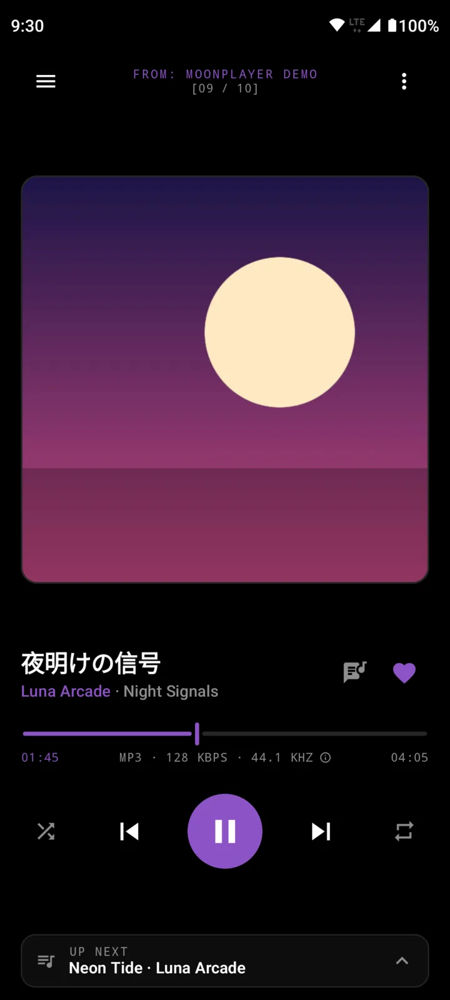
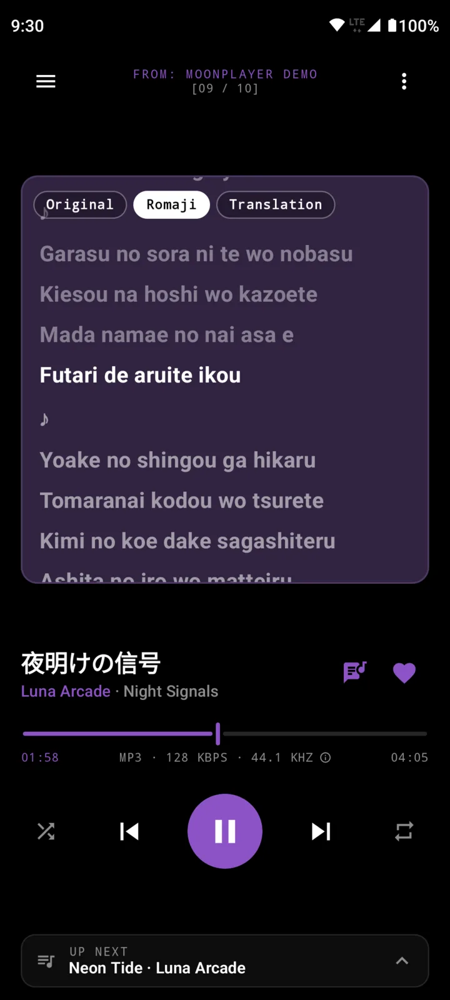
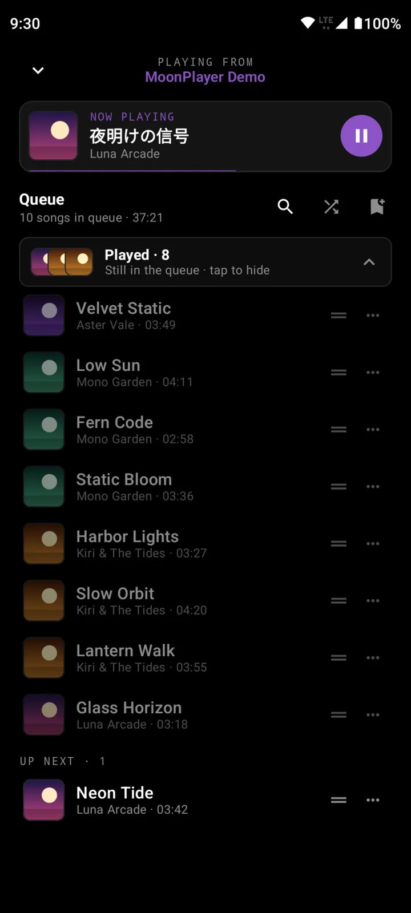
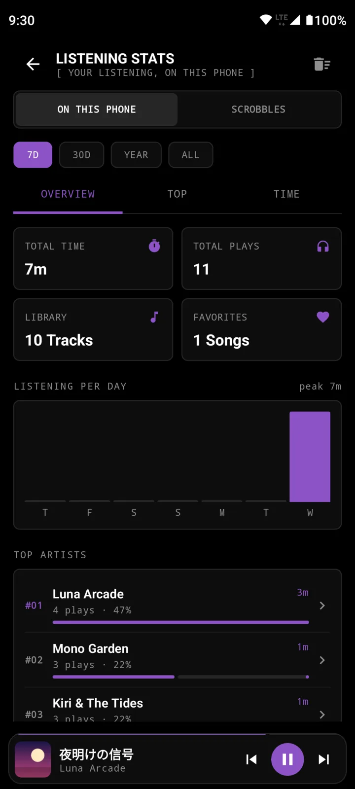
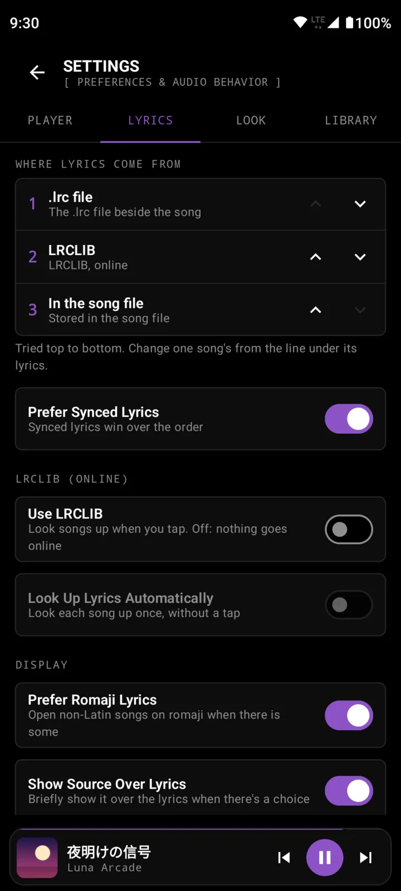

<div align="center">


# Moon Player

### An offline player for the music on your phone

Play MP3, FLAC, M4A, OGG, Opus and WAV files from your own folders on Android. No ads, no accounts, no telemetry.

[](https://github.com/Moon-Ecosystem/MoonPlayer/releases)
[](https://github.com/Moon-Ecosystem/MoonPlayer/actions/workflows/build-and-release.yml)
[](#download)
[](LICENSE)







</div>

## Download

Grab the newest signed APK from [Releases](https://github.com/Moon-Ecosystem/MoonPlayer/releases/latest). Tagged versions (such as 0.2) are full releases; every merge to `main` also publishes a pre-release, **Moon Player Alpha N**. Each installs over the previous one.

_Requires Android 7.0 (API 24) or higher._

## Features

- **Your folders, nothing else.** Pick one or more folders with Android's folder picker and Moon Player finds every song inside them, subfolders included. No storage permission, and the library loads instantly from its saved scan.
- **Player:** one row of controls (shuffle, previous, play, next, repeat), a large cover, and the song's format, bitrate and sample rate. The accent colour follows each album cover, or pick a preset or your wallpaper colour (Android 12+).
- **Synced lyrics:** tap the cover to swap it for lyrics that follow the song; tap a line to jump there. Scroll away and an arrow brings you back to the line being sung. Lyrics come from a `.lrc` file next to the song, from lyrics stored in the song file itself (MP3, M4A, FLAC, Ogg, Opus), or, if you allow it, from [LRCLIB](https://lrclib.net/). Songs can switch between Original, Romaji and Translation. When a song has lyrics from several places, the line under them says which one is shown; tap it to pick another for that song. Synced lyrics win by default, then the source order you set in Settings › Lyrics.
- **Queue:** swipe up from the player. Drag (long-press the handle) to reorder, Play Next from a song's menu, played songs fold away, and the whole queue can be saved as a playlist.
- **Playlists:** your own playlists with drag-to-reorder, plus every library folder as a live playlist that always matches its contents.
- **Browse:** all songs, albums, artists, folders, favorites and recently played. A song tagged with several artists ("A, B" or "A/B") is listed under each; well-known names like Earth, Wind & Fire stay whole, and any name can be split or joined from its artist page (⋮ › How this name splits). A mini player with previous, play/pause and next sits under every screen.
- **Sound:** 5-band equalizer with presets matching Android's own curves, bass boost, playback speed and an A-B loop, all in the player's ⋮ menu.
- **Sleep timer:** stop after a set time or at the end of the current song.
- **Statistics:** total listening time and plays, top tracks, top playlists and your library by format. Optionally, the stats your scrobbler sends to Last.fm or Libre.fm, from just your username.
- **Plays well with Android:** media notification and lock-screen controls with cover art, headset buttons, pausing when headphones disconnect, and resuming your last queue on launch. Scrobblers such as [Pano Scrobbler](https://github.com/kawaiiDango/pano-scrobbler) pick up what's playing.

## Supported formats

| Format                     | Status       |
| :------------------------- | :----------- |
| `.mp3`                     | ✅ Supported |
| `.flac`                    | ✅ Supported |
| `.m4a`, `.aac`             | ✅ Supported |
| `.ogg`, `.oga`, `.opus`    | ✅ Supported |
| `.wav`                     | ✅ Supported |

Cover art is read from the file's embedded artwork, or a `cover.jpg` (or similar) in its folder.

## Lyrics files

To use your own lyrics, put a `.lrc` file with the same name next to the song:

```text
Music/
└── J-pop/
    ├── Yoru ni Kakeru.mp3
    └── Yoru ni Kakeru.lrc
```

By default a `.lrc` file comes first, then LRCLIB, then lyrics stored in the song file, and synced lyrics win over unsynced ones; both can be changed in Settings › Lyrics. Plain text without timestamps is shown as unsynced lyrics.

## Privacy

- Folder access is limited to the folders you pick. The app never requests a storage permission.
- The app goes online for two optional things only:
  - **Lyrics lookups**, chosen at first start: off, only when you tap Look up, or automatically (and changeable in Settings › Lyrics). A lookup sends the song's title, artist, album and length to LRCLIB, nothing else.
  - **Scrobble stats**, only if you connect a Last.fm or Libre.fm username. They're read from that account's public profile; Moon Player never logs in or scrobbles.
- Your library, playlists, favorites, statistics and saved lyrics stay on the device.
- No analytics, ads or crash reporting.

## Building from source

You need JDK 17 or newer and an Android SDK with platform 37. The Gradle wrapper (Gradle 9.9.0) is included.

```sh
git clone https://github.com/Moon-Ecosystem/MoonPlayer.git
cd MoonPlayer
./gradlew :app:testDebugUnitTest   # unit tests
./gradlew :app:assembleDebug       # debug APK (needs debug.keystore at the repo root)
```

Create the debug keystore once with:

```sh
keytool -genkeypair -keystore debug.keystore -alias androiddebugkey -storepass android \
  -keypass android -keyalg RSA -validity 10000 -dname "CN=Android Debug"
```

Release builds are signed with the key at `KEYSTORE_PATH` (alias `upload`), using `STORE_PASSWORD` and `KEY_PASSWORD` from the environment.

Built with Kotlin, Jetpack Compose (Material 3), Media3 ExoPlayer, Room and Coil.

## Contributing

Pull requests are welcome; for larger changes, open an issue first. Development happens on `dev`, and `main` is release-only since every merge to it ships a build. Commits follow [Conventional Commits](https://www.conventionalcommits.org/).

## License

Distributed under the [MIT License](LICENSE).
